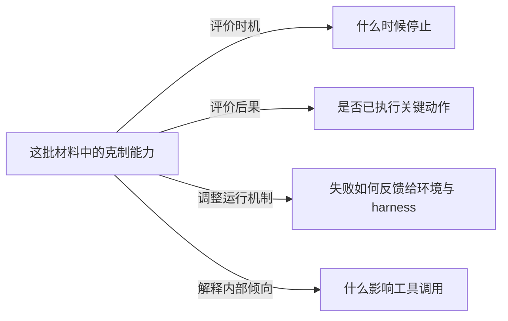

# 规则建立验收与静态案例演练

日期：2026-10-26。对象：[AGENTS.md](AGENTS.md)、[WORKFLOW.md](WORKFLOW.md)、[REPORT_TEMPLATE.md](REPORT_TEMPLATE.md)。

本次仅建立工作规则、模板和调用说明。本文件是静态验收记录，不是日报、真实五天热榜、独立论文复核或最新工具链测试。未运行新检索、正式研究、图像生成、实验或调度。

## 已完成的检查

- UTF-8 文本可读，无替换字符；Markdown 代码围栏成对；规则与模板互相可达。
- 主规则和流程对 18 次小红书搜索、24 篇详情、8 篇正文、两个短核查问题、最多两个并行 subagent 及生图上限的含义一致；失败/重试消耗预算，子任务不扩大总量。
- 发现评分仅服务本轮候选排序；贡献分析、科研相关性与证据强度独立。
- 独立工作区内写入，知识库只读；无自动 Ingest、Wiki 日志、定时器、Git 或实验路径。
- 正式报告与运行记录分开；模板强调聊天全文与 Markdown 同内容，允许图片路径适配，不要求读者接手研究任务。

## 数值约定：已执行合成算例

使用临时内存脚本按 WORKFLOW 的公式复算；没有建立可执行搜索引擎或生产排序程序。

| 合成候选 | 点赞 | 收藏 | 评论 | 候选集内发现分 |
| --- | ---: | ---: | ---: | ---: |
| A | 100 | 100 | 0 | 0.90 |
| B | 1 | 1 | 99,999 | 0.10 |
| C | 50 | 50 | 10 | 0.50 |

结果 A > C > B，评论暴增不覆盖点赞收藏的主要权重。另检查单候选、全并列时百分位为 0.5。此例不是现实帖子统计，不证明真实用户互动的质量。

时间算例：若 T 为北京时间 2026-10-26 08:00，窗口为 2026-10-21 08:00 至 2026-10-26 08:00，含边界；六天前的时间不合格。按带时区时间计算已通过。

## 边界情形：按规则逐项静态走查

以下是规则路径演练，不是对真实平台执行结果的声明。

| 情形 | 规则给出的处理 | 结果 |
| --- | --- | --- |
| 评论极高但点赞收藏低 | 按 45/45/10 百分位排序，不以评论独占重点 | 上方算例通过 |
| 高互动广告或招聘 | 相关性过滤先于发现分；简记排除原因 | 无论热度高低都不进入主报告 |
| 一周检索返回六天前帖子 | 按实际发布时间筛五天 | 排除榜单资格 |
| 日期未知或相对日期跨边界 | 单列日期待确认；可作背景，不混入确认榜单 | 不制造精确五天覆盖 |
| 互动数缺失或显示“1.2万” | 保留缺失/近似；不填零、不算严格总名次 | 可定性选择并说明 |
| 同论文三篇转载 | 合并稳定身份；代表帖说明热度，证据只计一次 | 不累加互动制造研究共识 |
| 旧论文刚被发帖介绍 | 区分两种日期，写旧工作重新传播 | 不标成新论文 |
| 连续两天没有实质变化 | 简短提示持续关注或跳过 | 不重写长文、不凑满十分钟 |
| 新版本出现 | 核对增量后再决定展开 | 版本号本身不算新贡献 |
| 原文不可得 | 尝试官方可读格式后仍失败则降级或替换 | 不用二手信息冒充核读 |
| 短核查没有答案或已达预算 | 写影响哪项判断以及缺失，结束该分支 | 不递归开研究 |
| subagent 不可用 | 主 Agent 串行完成并记录 | 不冒充独立审查 |
| 生图不可用或修订仍不准确 | 用可显示的确定性图或简洁文字 | 不自动切付费 API |
| 有成稿但聊天未交付 | 待发送状态，不先登记已交付 | 下一轮先恢复 |
| 数据/表述冲突 | 保留范围、版本和差异；必要时修正旧判断 | 不静默抹平 |

## abstention 历史材料的模板演练

输入只读自 [2026-10-26 试运行记录](archive/social-scout_20261026/RUN.md) 的“6篇原始材料的定向阅读与判断边界”和“分流”部分。这里只演练信息组织，不重新认证其中论文、会议身份、时间与数值，也不把历史记录当独立原始证据。该材料为历史试跑，不作为当前执行规则，日常运行不读取；归档说明与迁移哈希见 [ARCHIVE.md](archive/social-scout_20261026/ARCHIVE.md)。正式报告需要相关证据时重新核读原文。

### 可采用的开场

这批材料把“Agent 什么时候该克制”拆成了几种不同尝试：评价停止的时机、检查关键动作是否已经造成后果、根据失败调整运行机制，以及解释模型调用工具的倾向。它们虽然共享“停手”这个直觉，改变的研究对象并不相同。早期求助和选择性退出工作也提醒我们，这不是所有问题都刚刚出现的新领域。

此开场只概括历史试跑中的内容差异，不声称五天热榜、升温趋势或全领域覆盖。

### 两项重点怎样安排

**重点一：评测开始追问“什么时候停，以及停之前做了什么”。**

用“第一次搜索没有结果”和“已经取消旧票才宣布无法改签”两个不同情境，分别解释时机与动作后果。依据历史记录，Agentic Abstention 和 AgentAbstain 可放在这一对照中；近邻求助工作用于说明连续性。先讲研究对象和评价增量，再用一句限定提醒“预设停止时点不一定等同于实际取得证据的时刻”。指标审计不作为本期主线，若其细节不改变这层解释即可挂起。

**重点二：从固定规则，走向根据失败调整环境与 harness。**

用“系统在哪里失败，就补什么任务、改什么运行条件”解释历史记录中的 HERA。说清它改的是环境与运行机制之间的反馈，并保留原记录关于各项指标并非全面领先的限制。不把它写成已证泛化提升或共同演化普遍最优。

**短观察：可以改变是否调用工具，不等于已经判断对何时调用。**

历史记录中的 Tool-Call Vector 可用于引出机制干预和合适行动之间的区别。留下一个有启发的联系即可，不默认追加源码审计或实验计划。

### 关系图的静态设计

该图表达并列分析维度，不表示四项互为因果或时间演进。正式版本应在相应节点解释旁附原始证据；本图只是基于历史记录的编辑示意。

**演练判断：**可以用两个重点与一个短观察覆盖四种尝试，先呈现不同贡献，再保留局部问题；无需把报告收束为“继续查停止时点”。这验证了模板的组织路径，不等于已经产出合格的真实日报。

## 未测范围与后续使用

- 未重新打开原帖、原论文、OpenReview 或代码；未确认真实五天覆盖和互动数据完整性。
- 未生成任何最终图片；未进行聊天、Mermaid 或 Markdown 阅读器的视觉实测。围栏检查不等于渲染通过。
- 未比较一次真实的聊天全文与报告文件，因为本次未发布正式报告；规则已规定内容一致和路径适配方式。
- 未创建调度、未验证 Dot 或其他环境能自动访问本目录。实际调用前须读取规则并检查当前工具能力。
- 本次结果是可执行规则及静态案例验收；第一次真实运行仍需检查检索覆盖、视觉和交付。无需因此扩大本次任务范围。
