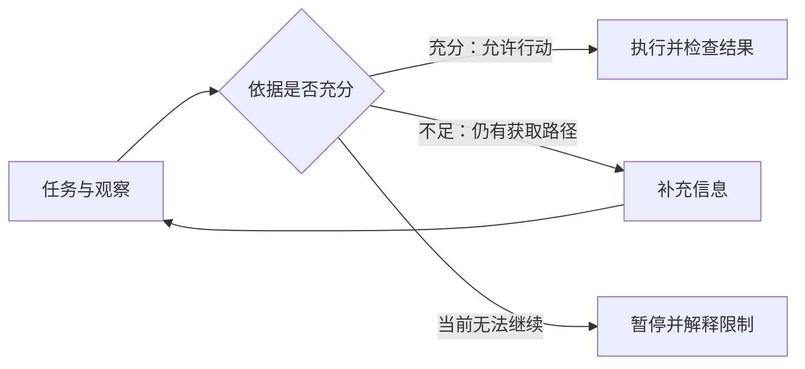

# 日报模板与编辑说明

规则入口：[AGENTS.md](AGENTS.md)。以下为可删改的阅读骨架，不是填表任务。正式交付删除所有占位提示；用具体标题，材料不足可删栏目。正文一般 1,800–2,800 汉字，来源与简短图注另计。十分钟不是必须读满的配额。

默认读者了解一些 Agent，但没有读过本轮论文。每个重点用一个具体场景切入，术语首次出现用一句白话说明；不要求读者先看来源才能理解。

---

# Agent 科研观察 · {{北京时间日期}}
## {{本轮最值得知道的变化，用具体内容作标题}}

观察窗口：{{北京时间起止}}。{{通用/专题覆盖}}。
{{一句覆盖说明：本轮实际搜索/阅读及重要缺失；只称检索范围内的高互动话题。}}

{{约 100–180 字：两三句话讲清这一批材料里发生了什么变化。说明哪些是新工作，哪些是旧工作的新传播；不从首次扫描宣称升温。}}

## {{重点一：一个能引出机制的具体问题或变化}}

{{约 450–650 字：场景 → 旧做法 → 这项工作做了什么、哪个环节改变 → 为什么可能有用 → 已提供的证据与边界。贡献类型自然写进解释，不堆六类标签。}}

{{在最需要解释的位置插入一幅旧新对照、流程或机制图；没有额外价值可省略。图注说明来源与推断部分。}}

{{核心判断附近给原帖与原始证据链接和定位；作者声称的新意与核对确认的增量分开。尚未读到近邻则明确说未确认。}}

{{结尾可保留一个有启发的疑问，或一句“这改变了怎样的理解”。不强制提出研究方案。}}

## {{重点二：不同路线或现象}}

{{与重点一相同的解释完整性，采用适合内容的表达；不要机械复制段落结构。优先呈现另一类尝试，避免两项都变成同一论文的评测疑点。}}

{{可以用场景示意图表达一个反直觉关系；用图后删掉逐项复述图中节点的文字。}}

## 还值得知道

{{1–3 条，每条约 120–220 字；各自有具体发现、增量或值得注意的联系和来源。没有内容就少写。已报道但仍热门者一句提示，不重讲原有全文。}}

## {{可选：留下的一个问题／两个有意思的联系}}

{{约 100–200 字。区分已知事实、报告推断和未验证设想。没有合适内容就删掉。不要附一整套需要用户接手的研究任务。}}

## 来源与观察边界

{{按话题给必要补充链接；正文已经给全的不用重复。写明实际读取范围、图像/评论/论文/评审的关键缺失，以及影响哪项判断。流程细节放 record，不占阅读篇幅。}}

---

## 视觉选型与约束

- 优先 1–3 处有解释价值的视觉，少材料不凑图。开场图只有能解释整体关系时才使用；不要把所有图集中堆到正文前。
- 用图解释：两个做法改变了哪个环节、行动如何分支、哪些信息进入决策、反馈如何回来。不要画无解释作用的关键词连线。
- Mermaid 精确图示的可改写示例（仅示范表达，不代表真实研究结论）：

- 生成图适用于场景化机制解释，先整理证据、箭头和限定，再调用内置生图。配色清晰、短标签、突出一个关系；趣味性来自具体场景和反直觉变化，不靠夸大标题。
- 不绘制虚构论文结果；真实数字用确定性图形。生成图图注写“本报告绘制的示意图”，原图摘录写来源与 PDF 页码。
- Markdown 中图片引用已保存的相对路径并写有意义的 alt；聊天转换为绝对路径并确认可显示。同一内容不另维护“简版”和“长版”。
- 如果只能显示文字，保留完整解释；说明相关视觉未渲染，不交付一大段图代码冒充看图阅读。

## 编辑验收清单

- 不打开链接，也能理解具体做法、旧新差异、贡献和主要边界。
- 重点首先讲研究内容，不能先花数段谈规则、工具、指标疑点或下一轮计划。
- 热门不等于有效；一项工作不扎实也不自动抹去其问题启发，分别说明。
- 原帖、论文、推断和设想能辨认；“新”有参照；旧论文再传播有标签。
- 同一论文转载已合并；共同作者或同源项目不冒充独立复现。
- 图确有解释作用、箭头不偷换因果，图与证据/正文一致，引用可达；未实测的显示范围写清楚。
- 已删除占位符、图节点复述、模板式过渡和不必要表格；全文可在约十分钟内轻松阅读。
- 聊天是全文，Markdown 是同一报告存档；仅链接/图片路径作显示适配。
