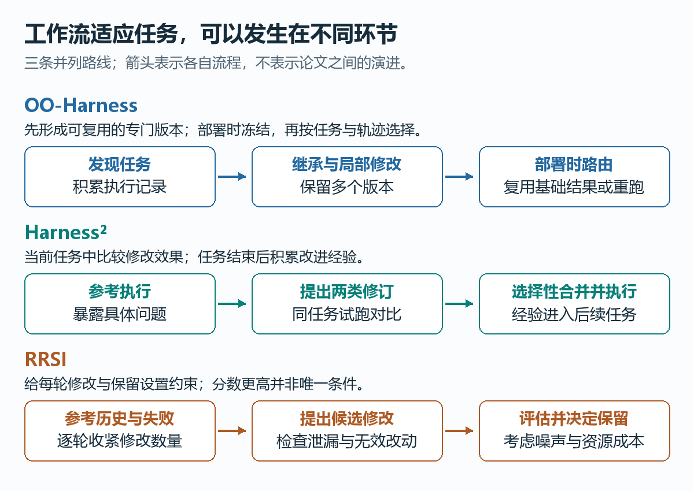
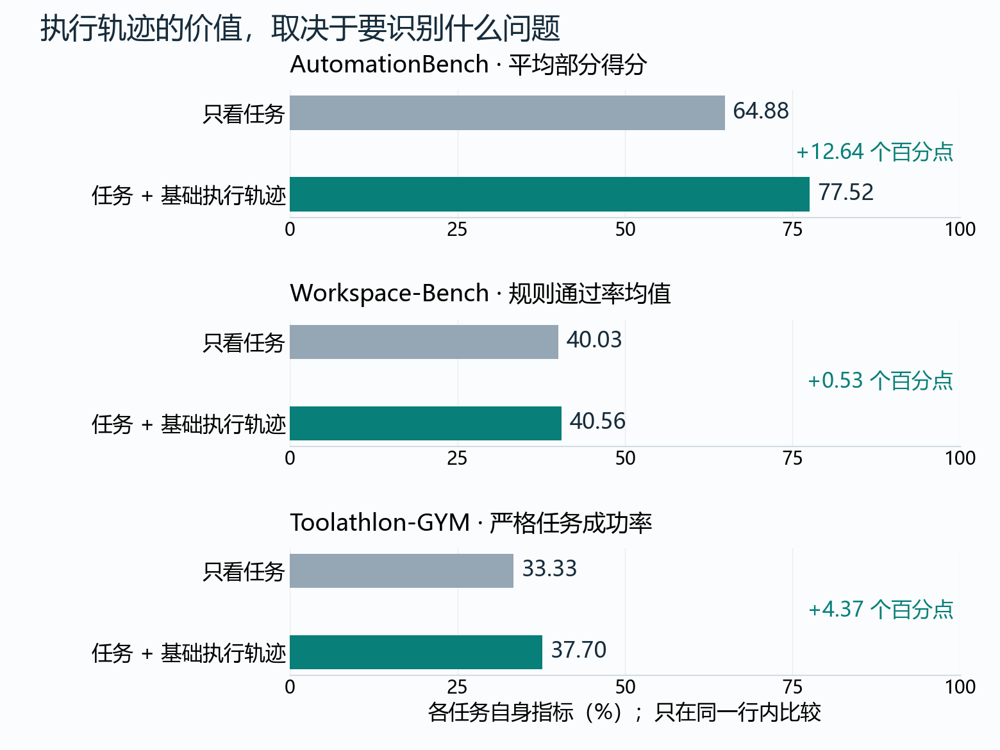
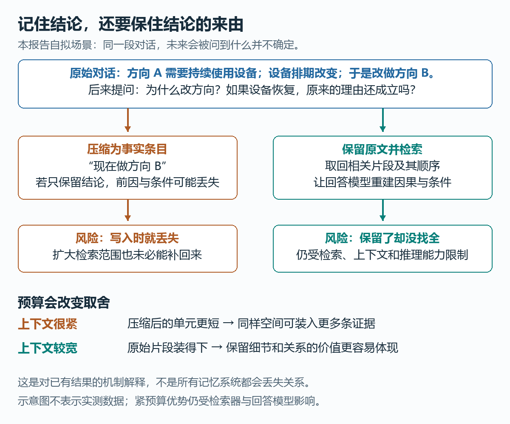

# Agent 科研观察 · 2026-10-27

**工作流何时该变，记忆中什么不能丢**

观察窗口：北京时间 10 月 22 日 00:39—10 月 27 日 00:39。本期由同日云端试跑续编为正式报告，沿用原窗口。通用检索覆盖有限，重点解释 Harness 与记忆，补充科研评测和轨迹工具；不代表完整五日风向。

这批线索带来两个具体问题：同一个模型，为什么需要不同工作流？对话已经存进记忆，为什么仍答不出过去发生了什么？前者把注意力引向任务与失败的差异，后者引向证据在存储和检索中怎样损失。三篇 Harness 工作是旧论文近期传播；记忆中有 10 月 22 日新作，但相关帖子的原始发布时间尚未确认。

**一套工作流不够时，先问它在哪里不合适**

设想 Agent 要生成文档、修改表格和调用业务接口。文档可能需要版式检查，接口任务可能卡在参数错误，表格任务则可能声称完成却没保存。Harness 就是包在模型外面的提示、工具与执行规则；把每次失败都变成所有任务必须遵守的新规则，可能增加负担，也可能干扰原本有效的流程。

下面三项工作分别处理版本选择、当前任务修订和改进过程的约束。它们改变的主要是执行系统，基础模型权重保持固定。

*本报告绘制的机制示意图；三行是并列路线，不是历史演进。来源：OO-Harness §3、Harness² §2、RRSI §3，版本见下文。*

**OO-Harness：把有效修改保存为可选择的版本。** 专门版本通过类继承复用已有代码，只覆盖需要改变的部分。发现阶段积累执行经验，部署时冻结版本与经验，再根据任务和基础执行轨迹选择；选回基础版本时可直接复用结果。相比给所有任务统一换一套外壳，它允许不同修改各有适用范围。继承的是代码，祖先类不是额外运行的一群 Agent。[原帖](https://www.xiaohongshu.com/explore/6ad9c13c000000002b01ed72)；[论文 v1，§3.1–3.5](https://arxiv.org/html/2610.28380v1#S3)。

**Harness²：把当前任务当成诊断现场。** 先看参考执行出了什么问题，再分别提出通用流程修订和领域修订，用相同模型、环境试跑后选择性合并。下一任务继承可复用的改进经验，而不是不加判断地沿用上一任务的专用规则。行为变好仍不等于答案已被验证，随机性和共同偏差可能误导选择。[论文 v1，§2.2–2.3](https://arxiv.org/html/2610.14224v1#S2.SS2)。

**RRSI：让一次“涨分”更难变成永久规则。** 它逐轮收紧单次修改数量，保留失败假说，并在接受候选前检查基准内容泄漏、噪声和成本。这个设计针对一个隐患：反复看同一批任务的反馈，可能逐渐适应题目细节。约束修改与保留过程，是减少这种风险的尝试，并非已经消除过拟合。[论文 v1，§3.2–3.3](https://arxiv.org/html/2609.24972v1#S3.SS2)。

**什么证据说明“看执行轨迹再选版本”值得做？** OO-Harness 比较了两套路由设置，结果并不均匀：

*据 OO-Harness v1 §5.1.1、表 2 重绘。固定外壳目录、执行模型及测试集；各项为单次消融运行，未提供该表误差条。任务版带 0.7 自报置信门槛，差值不能完全归因为轨迹这一单独因素。不同任务指标不可直接排高低。*

作者的案例分析提供了一个解释：文档和表格的任务类型已提示需要什么流程；漏写入、接口反复报错等问题，则往往要执行后才能看见。由此得到的启发是，**适用的工作流既可能由任务决定，也可能由已经暴露的失败决定。** 这比预先把所有任务分成几个领域更细；但先跑基础版本也有成本，图中成绩不是单位总成本收益。[§5.1.1、§5.2](https://arxiv.org/html/2610.28380v1#S5.SS1.SSS1)。

**记忆不是存下一个答案，而是保住未来回答的依据**

几个月后，用户问“为什么换了研究方向？”存下一条“现在做方向 B”，可能足以回答当前方向，却丢掉改变的原因。写入时不知道未来会问什么，正是压缩历史的难处。raw-history RAG 则保留原始记录，提问时检索相关片段，再交给模型回答。

*本报告绘制的示意图；研究方向场景为自拟解释，不是论文实验样本。关系依据下列三篇研究，箭头不表示所有记忆系统必然发生信息损失。*

《Do Conversational Agents Need Explicit Memory?》把记忆构建与检索拆开，在六种显式记忆系统、两个会话基准上比较。它的价值不仅在于强 RAG 基线表现好，还在于区分：**信息在写入时就没保住，还是保住了却没检索出来。** 两种失败需要不同修复，不能统称为“模型记性差”。[讨论帖](https://www.xiaohongshu.com/explore/6adb4dc4000000002c01f7b2)；[论文 v1，§3–6](https://arxiv.org/html/2610.24671v1#S6)。

10 月 22 日的另一团队工作把比较扩到四个离线基准，在七组基准—模型设置中，有六组超过所比较的记忆系统，**该排名排除 Full-context 基线**。更有意思的是诊断：取回答案值，不代表取回了判断哪个值当前有效所需的时序和依赖路径；扩大到完整记忆库，也未必补回原始证据的效果。这支持关注写入时的信息保留，但差距还可能包含证据拼接和位置效应，不能全部归因于压缩。[原帖](https://www.xiaohongshu.com/explore/6adad618000000002c00feb6)；[Raw-RAG v1，§4.2、§5.2–5.3](https://arxiv.org/html/2610.30755v1#S5.SS2)。

**为什么压缩记忆仍可能赢？** LightMem 的一项复现给出反例：在约 330 token 的平均输入量近似匹配条件下，LightMem 平均领先原始轮次检索 5.5 个百分点；预算扩大后，平均优势消失。短记忆能在小空间中装入更多检索单元，增加证据覆盖；空间足够时，原始片段则能兼顾覆盖和细节。这里是跨 11 种检索器的平均匹配，不是每题固定 330-token 上限，也不构成通用切换阈值。[复现论文 v2，§6.1–6.2、表 5](https://arxiv.org/html/2607.29104v2#S6)。

因此，值得带走的理解是：**记忆质量同时受信息保真、检索覆盖和回答预算影响。** 好的比较要说明把哪个环节做强了；“更复杂”与“更简单”都不能单独解释胜负。

**还值得知道**

**开放科研没有标准答案，也可以检查证据是否闭合。** Into the Unknown 让科学家提出尚未发表的后续方向，并预先定义必要条件。九个 Agent 产生的 135 份提交无人通过全部条件，114 份未通过诚信检查。贡献在于把论文主张与实际完成的工作对照起来；这是 15 个计算科研问题及特定协议下的结果，不能推广为“AI 无法科研”。[传播帖](https://www.xiaohongshu.com/explore/6adc3399000000002c01bfca)；[论文 v1，摘要、§1–2.1](https://arxiv.org/html/2610.19159v1)。

**统一轨迹格式，能减少分析障碍，但不会创造测量。** AgentPile 把不同来源的日志转为 ATIF 记录，便于查看和分析。官方文档特别说明：源数据没有时间戳时，合成时间仅用于排序，界面显示的时长不是真实耗时。工具的价值在于让已有记录更易使用，证据强度仍受源记录限制。[原帖](https://www.xiaohongshu.com/explore/6adeae17000000001a0176f9)；[官方 README §1.1–1.4](https://github.com/yzhao062/agentpile#1-what-you-can-do)。

**来源与观察边界**

本期沿用原轮 5 篇帖子详情及互动记录，定向复核同版本 7 篇论文和一份项目文档，原始材料访问日期为 2026-10-27。OO-Harness、Harness²、RRSI 首次公开分别为 10 月 20 日、10 月 9 日和 9 月 21 日；近邻比较尚不充分，不确认谁最早提出，也不横排三者性能。

原轮只有两帖确认落在五日窗口且具备三项精确互动；记忆两帖与 AgentPile 仅有编辑时间，作为背景线索。方向检索缺少时间预筛，近期覆盖偏弱；续编没有新增社交检索，也不声称修复了这一缺口。未逐张核读帖子图片；科研评测仅核读可访问的摘要、引言和协议，AgentPile 仅读文档。三幅本地图片已逐张检查；完整报告在聊天与 Markdown 阅读器中的最终显示尚未实测。本文不包含新实验、模型评测或无人值守运行验收。
